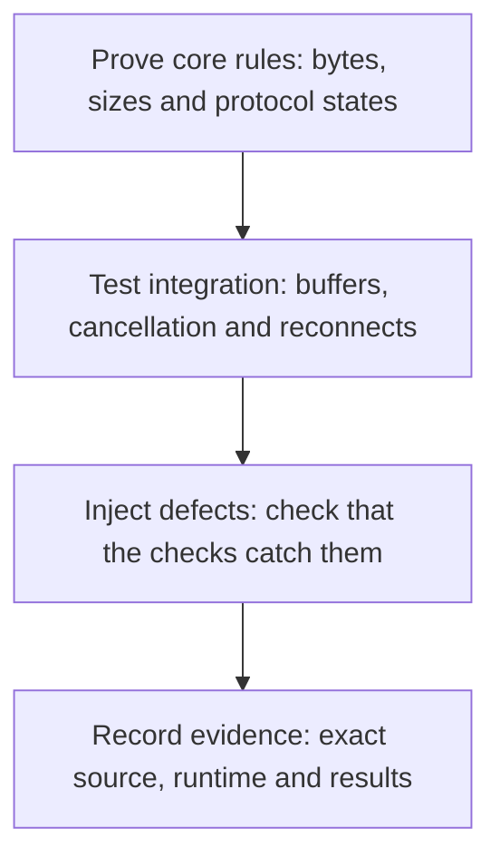

# WebSocket Client Lite (Rx)

[](https://www.nuget.org/packages/WebsocketClientLite.PCL)
[](https://www.nuget.org/packages/WebsocketClientLite.PCL)
[](https://github.com/1iveowl/WebsocketClientLite.PCL/actions/workflows/ci.yml)
[](https://github.com/1iveowl/WebsocketClientLite.PCL/actions/workflows/build.yml)
[](License.md)

[](https://dotnet.microsoft.com/)
[](https://learn.microsoft.com/dotnet/standard/net-standard)
[](https://reactivex.io/)
[](verification/README.md)
[](https://tools.ietf.org/html/rfc6455)

*Please star this project if you find it useful. Thank you.*

## TL;DR

See the project `NETCore.Console.Test` in the `./src/test` directory for an example of how to use.

## A Lightweight Cross Platform WebSocket Client

This library is a ground-up implementation of the WebSocket specification [(RFC 6455)](https://tools.ietf.org/html/rfc6455) - it does not rely on any built-in .NET WebSocket libraries.

The library provides developers with additional flexibility, including the ability to establish secure WSS websocket connections to servers with self-signing certificates, expired certificates, etc. This capability should be used with care for obvious reasons, but is valuable for testing environments, closed local networks, local IoT set-ups, and more.

The library utilizes [ReactiveX](http://reactivex.io/) (aka Rx or Reactive Extensions). While this dependency introduces a small learning curve, it's worthwhile for the context.

## Confidence through proof driven development

A small client still needs to handle difficult edge cases. **Proof driven development (PDD)** gives this library layers of evidence, from the bytes on the wire to cancellation and reconnect behavior.



This work has brought earlier rejection of malformed frames, safer fragmented sends and buffer ownership, and more reliable teardown and sequential reconnect cleanup. Dafny proofs cover core algorithms under explicit assumptions; controlled tests exercise the surrounding C#. Mutation checks challenge both, while revision-bound evidence makes future regressions easier to detect and investigate.

The result is stronger assurance with explicit limits. Explore the [layers, guarantees and boundaries](docs/protocol-verification.md#layers-of-proof-driven-development).

## Usage Guide

### Creating a WebSocket Client

Instantiate the `ClientWebSocketRx` class:

```csharp
await using var client = new ClientWebSocketRx { 
    IgnoreServerCertificateErrors = true, 
    Headers = new Dictionary<string, string> { { "Pragma", "no-cache" }, { "Cache-Control", "no-cache" } },
    TlsProtocolType = SslProtocols.Tls12 };

```

`await using` (i.e. `DisposeAsync`) is the preferred lifecycle: when the client goes out of scope, the RFC 6455 close handshake of any still-active connection is awaited before the socket is released. It has two separate waits, not one deadline: up to five seconds for the Close frame to be sent, then up to five more for the server's Close. If the send times out, the connection is disposed right away without waiting for the server. Disposal also waits for your callbacks and for the stream to return, so it is not guaranteed to finish within ten seconds. A plain `using`/`Dispose()` also works but is the abrupt variant — the close is attempted best-effort within a bounded time (3 seconds) so synchronous disposal can never hang. Unsubscribing from the connection observable remains the usual way to end a single connection; disposal is for the client object's end of life.
You can also provide your own `TcpClient` for greater control:

```csharp
TcpClient tcpClient = new() { LingerState = new LingerOption(true, 0) };
var client = new ClientWebSocketRx { TcpClient = tcpClient, HasTransferSocketLifeCycleOwnership = false };
```

> Note: 
>
> - If the TcpClient is not connected already the library will connect it. 
> - The TcpClient will not be disposed automatically when passed in using the constructor unless `HasTransferSocketLifeCycleOwnership = true` is set.
> - **A supplied `TcpClient` can only serve one connection.** Its socket is closed when the connection tears down, and .NET sockets cannot be reconnected. If you use reconnect patterns such as `Retry()`/`Repeat()`, leave `TcpClient` unset so every attempt gets a fresh socket.

Sequential reconnect with `Retry`/`Repeat` creates a new internal socket and Sender
for each attempt. A cached old `Sender` remains tied to its old connection and
fails sends after teardown; obtain `client.Sender` again after reconnecting.
`Sender` can remain non-null while disconnected. Cleanup from a terminated attempt
does not reset the successor's connected status or dispose its transport.
Disposing the client permanently ends admission: later subscriptions fail with
`ObjectDisposedException`. Unsubscribe to end one attempt while keeping the client
available. Use a finite retry policy that stops when you dispose the client.
One active subscription per client at a time is the supported use: subscribe
again only after the previous attempt has ended, as `Retry`/`Repeat` do. With two
active subscriptions on one client, `IsConnected` and `Sender` are not specified;
use separate clients for independent connections.

### Connecting to a WebSocket Server

To connect and observe WebSocket communication:

```csharp
using System.Reactive.Disposables;
using System.Reactive.Linq;

using CompositeDisposable disposables = new();

Func<IObservable<(IDataframe dataframe, ConnectionStatus state)>> connect = () =>
    client.WebsocketConnectWithStatusObservable(
        uri: new Uri("wss://ws.postman-echo.com/raw"),
        hasClientPing: true,
        clientPingInterval: TimeSpan.FromSeconds(10),
        clientPingMessage: "ping message",
        cancellationToken: cts.Token);

IDisposable connectionSubscription = Observable.Defer(connect)
    .Retry()
    .Repeat()
    .DelaySubscription(TimeSpan.FromSeconds(5))
    .Do(tuple =>
    {
        Console.ForegroundColor = (int)tuple.state switch
        {
            >= 1000 and <= 1999 => ConsoleColor.Magenta,
            >= 2000 and <= 2999 => ConsoleColor.Green,
            >= 3000 and <= 3999 => ConsoleColor.Cyan,
            >= 4000 and <= 4999 => ConsoleColor.DarkYellow,
            _ => ConsoleColor.Gray,
        };

        Console.WriteLine(tuple.state);

        if (tuple.state == ConnectionStatus.DataframeReceived && tuple.dataframe is not null)
        {
            Console.WriteLine($"Received: {tuple.dataframe.Message}");
        }
    })
    .Where(t => t.state == ConnectionStatus.WebsocketConnected)
    // SendMessages() is your own method that uses client.Sender once connected.
    .SelectMany(_ => Observable.FromAsync(_ => SendMessages()))
    .Subscribe();

disposables.Add(connectionSubscription);
```

### Handling Connection Status and Messages

The observable pipeline above logs each connection state and prints received messages. It automatically retries and repeats the connection on errors and ensures resources are cleaned up via the `CompositeDisposable`.
### Sending Messages

Once connected, use the WebSocket sender interface to transmit messages:

```cs
// Get the sender 
var sender = client.Sender;

// Send a simple text message 
await sender.SendText("Test Single Frame");

// Send a multi-part message 
await sender.SendText([ "Test ", "multiple ", "frames ", "message." ]);

// Send fragmented messages with control over the fragmentation process 
await sender.SendText("Start ", OpcodeKind.Text, FragmentKind.First); 
await sender.SendText("Continue... ", OpcodeKind.Continuation); 
await sender.SendText("End", OpcodeKind.Text, FragmentKind.Last);
```


`SendBinary` borrows the supplied array until its returned task completes. For a
binary list send, keep every array unchanged until the whole send completes; the
list snapshot copies references, not payload bytes. Repeated references to a stable
array are supported. Concurrent caller mutation is unsupported.

### Client ping

The client ping feature enables the WebSocket client to send ping messages at predefined intervals:

```csharp
var websocketConnectionObservable = 
    client.WebsocketConnectWithStatusObservable(
        uri: WebsocketServerUri, 
        hasClientPing: true, // default is false. 
        clientPingInterval: TimeSpan.FromSeconds(20), // default is 30 seconds.
        clientPingMessage: "my ping message"); // default no message when set to null.
```

For advanced scenarios, use the `SendPing` method on the `ISender` interface for full control over ping messages.

### URI schemes

The library supports the `ws`, `wss`, `http`, and `https` URI schemes. You can extend the supported schemes by overriding the `IsSecureConnectionScheme` method of the `ClientWebSocketRx` class. The default implementation looks like this:

```csharp
public virtual bool IsSecureConnectionScheme(Uri uri) => 
    uri.Scheme switch
    {
        "ws" or "http" => false,
        "https" or "wss"=> true,
        _ => throw new ArgumentException("Unknown Uri type.")
    };
```

### TLS/SSL Certificate Validation

Control certificate validation behavior:

```csharp
// Option 1: Ignore all certificate errors.
// ⚠️ WARNING: this disables ALL certificate validation and exposes the
// connection to man-in-the-middle attacks. Use it only for local testing
// against self-signed/expired certificates. NEVER enable it in production.
var client = new ClientWebSocketRx { IgnoreServerCertificateErrors = true };

// Option 2: Override the validation method for custom logic 
public override bool ValidateServerCertificate(
    object senderObject, X509Certificate certificate, X509Chain chain, SslPolicyErrors tlsPolicyErrors) 
{ 
    // Your custom validation logic here
	// Fall back to base implementation
    return base.ValidateServerCertificate(senderObject, certificate, chain, tlsPolicyErrors);
}
```

#### Certificate revocation

Revocation checking is performed during the TLS handshake by default
(`CheckCertificateRevocation = true`). If your environment cannot reach the
certificate's OCSP/CRL endpoints (e.g. some corporate proxies or air-gapped
networks), the handshake will fail; disable the check in that case:

```csharp
var client = new ClientWebSocketRx { CheckCertificateRevocation = false };
```

This setting has no effect when `IgnoreServerCertificateErrors` is `true`.

### Limiting incoming message size

By default the client rejects any incoming frame — or any reassembled
fragmented message — larger than 16 MiB, then tears down the connection. This
guards against a malicious or misbehaving server exhausting memory by declaring
a huge payload length or flooding fragments. Adjust or disable the limit with
`MaxFrameSize`:

```csharp
// Cap incoming frames/messages at 4 MiB.
var client = new ClientWebSocketRx { MaxFrameSize = 4 * 1024 * 1024 };

// Or allow up to int.MaxValue bytes (no explicit limit — not recommended
// when connecting to untrusted servers).
var unlimited = new ClientWebSocketRx { MaxFrameSize = 0 };
```

### Working with Specialized WebSocket Implementations

#### Slack RTM API

The [RFC 6455 section defining how ping/pong works](https://tools.ietf.org/html/rfc6455#section-5.5.2) seems to be ambiguous on the question whether or not a pong must include the byte defining the length of data-frame, in the special case when there is no data and the length of the data is zero.

When testing against for instance the Postman WebSocket test server [Postman WebSocket Server](wss://ws.postman-echo.com/raw) the data-frame byte is expected and should have the value 0 (zero), when there's no data in the data-frame. 

However, when used with the [slack.rtm](https://api.slack.com/rtm) API the byte should **not** be there at all in the case of no data in the data-frame, and if it is, the slack WebSocket server will disconnect.

To manage this *length-byte issue*, set the following property to `true`, in which case the zero-value length byte will not be added to the pong. This is required for Slack's RTM API and similar services:

```csharp
// Required for Slack's RTM API
var client = new ClientWebSocketRx { ExcludeZeroApplicationDataInPong = true };
```

Slack RTM also requires application-level ping messages:

```csharp
// Slack expects an application-level ping as a JSON text message.
// The id is your own correlation id; see "Sending Messages" above.
await sender.SendText("{\"id\": 1234, \"type\": \"ping\"}");
```

To further complicate matters the [slack.rtm api](https://api.slack.com/rtm) [seems to require a ping at the Slack application layer too](http://stackoverflow.com/questions/38171620/slack-rtm-api-disconnection-following-message-in-scala). 

For details read the **Ping and Pong** section of the [slack.rtm API documentation](https://api.slack.com/rtm) 

#### Socket.IO

For Socket.IO servers:

This library has also been tested with [socket.io](https://socket.io/docs/v4/). 

```csharp
var uri = new Uri($"http://{url}:{port}/socket.io/?EIO=4&transport=websocket"); 
var websocketObservable = client.WebsocketConnectWithStatusObservable(uri);
```

This will connect on the WebSocket layer with socket.io server. 

To further connect on socket.io level see documentation. For instance, typically a text message with the content `40` needs to be sent right after the connection have been established. Also, some socket.io server implementations seem to be very sensitive to the encoding of the messages that are being send, and will disconnect immediately if receiving a data-frame with a text message that does not comply with the expected socket.io encoding protocol.

For more see here: [WebSocket client not connecting to the socket.io server](https://github.com/socketio/socket.io/discussions/4299).

## Release history

| Version | Released | Summary |
| --- | --- | --- |
| [10.4.0](CHANGELOG.md#new-in-version-1040) | 2026-11-14 | .NET 11 target with Runtime Async; no API or behaviour change |
| [10.3.0](CHANGELOG.md#new-in-version-1030) | 2026-11-12 | No behaviour change: header length rule traced to RFC 6455, stronger header tests, typed core boundary |
| [10.2.0](CHANGELOG.md#new-in-version-1020) | 2026-11-08 | Stronger cancellation, teardown and sequential reconnect |
| [10.1.0](CHANGELOG.md#new-in-version-1010) | 2026-11-07 | Dafny core extended to receive admission, sending and closing |
| [10.0.0](CHANGELOG.md#new-in-version-1000) | 2026-11-07 | Proof driven development: protocol core verified with Dafny |
| [9.2.0](CHANGELOG.md#new-in-version-920) | 2026-11-07 | Dependency updates |
| [9.1.0](CHANGELOG.md#new-in-version-910) | 2026-07-25 | Unified teardown, `IAsyncDisposable`, new handshake parser |
| [9.0.2](CHANGELOG.md#new-in-version-902) | 2026-06-11 | Fixes a close-on-unsubscribe race in 9.0.1 |
| [9.0.1](CHANGELOG.md#new-in-version-901) | 2026-06-11 | Correctness and robustness fixes |
| [9.0](CHANGELOG.md#new-in-version-90) | 2026-06-06 | Correctness and protocol compliance |
| [8.0](CHANGELOG.md#new-in-version-80) | 2025-03-16 | Renamed to `ClientWebSocketRx`; TCP socket lifecycle ownership |

The full notes for each release are in [CHANGELOG.md](CHANGELOG.md). Earlier releases, and 8.1 to 8.3, are on [GitHub Releases](https://github.com/1iveowl/WebsocketClientLite.PCL/releases).

## References

This library was developed using the following reference documentation:

- [RFC 6455 - The WebSocket Protocol](https://tools.ietf.org/html/rfc6455)
- [MDN - Writing WebSocket Servers](https://developer.mozilla.org/en-US/docs/Web/API/WebSockets_API/Writing_WebSocket_servers)
- [MDN - Writing WebSocket Server in C#](https://developer.mozilla.org/en-US/docs/Web/API/WebSockets_API/Writing_WebSocket_server)
- [MDN - Writing WebSocket client applications](https://developer.mozilla.org/en-US/docs/Web/API/WebSockets_API/Writing_WebSocket_client_applications)

## Building and Contributing

This library targets .NET Standard 2.0, .NET Standard 2.1, .NET 8, .NET 9, .NET 10, and .NET 11. Please keep changes compatible with all of them. GitHub Actions builds, tests, and publishes the packages. See [CONTRIBUTING.md](CONTRIBUTING.md) for how to send a pull request and how changes become releases.

With the [.NET 11 SDK](https://dotnet.microsoft.com/download/dotnet/11.0), which builds every target framework:

```bash
dotnet build src/main/WebsocketClientLite.sln
./test-all-tfms.sh    # the tests against every target framework build
```

The repository also ships a ready-to-use **dev container** (the .NET SDK, GitHub CLI, Claude Code, Codex and Herdr already installed). It runs locally or on a remote Linux host over SSH, and its agents can run side by side in [Herdr](https://herdr.dev/). See **[docs/development.md](docs/development.md)** for setup, testing details, and these options.

## Thank You

Thank you to all the developers who have used this library over the years, reported issues, submitted bug fixes, or made contributions to improve the library. Your feedback and support make open source development rewarding and educational.
