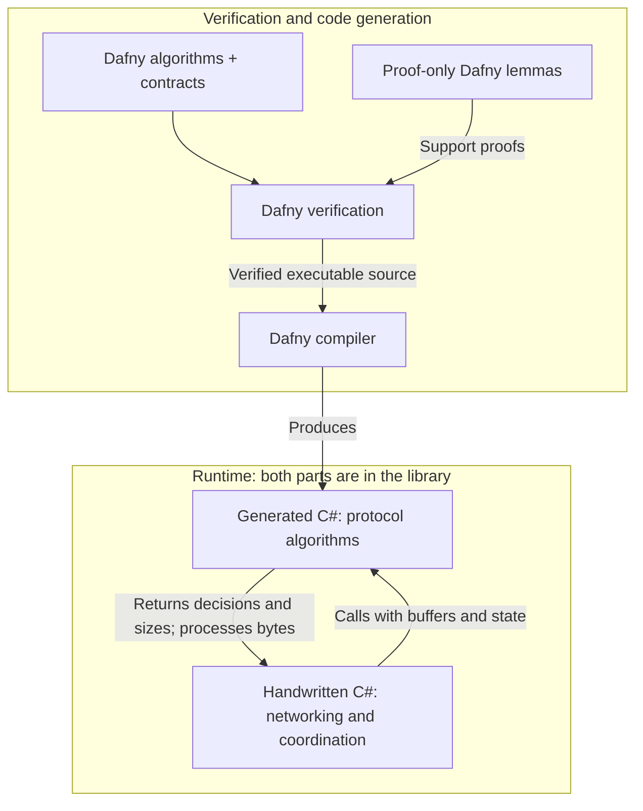

# WebSocket Client Lite (Rx)

[](https://www.nuget.org/packages/WebsocketClientLite.PCL)
[](https://www.nuget.org/packages/WebsocketClientLite.PCL)
[](https://github.com/1iveowl/WebsocketClientLite.PCL/actions/workflows/ci.yml)
[](https://github.com/1iveowl/WebsocketClientLite.PCL/actions/workflows/build.yml)
[](License.md)

[](https://dotnet.microsoft.com/)
[](https://learn.microsoft.com/dotnet/standard/net-standard)
[](https://reactivex.io/)
[](verification/README.md)
[](https://tools.ietf.org/html/rfc6455)

*Please star this project if you find it useful. Thank you.*

## TL;DR

See the project `NETCore.Console.Test` in the `./src/test` directory for an example of how to use.

## A Lightweight Cross Platform WebSocket Client

This library is a ground-up implementation of the WebSocket specification [(RFC 6455)](https://tools.ietf.org/html/rfc6455) - it does not rely on any built-in .NET WebSocket libraries.

The library provides developers with additional flexibility, including the ability to establish secure WSS websocket connections to servers with self-signing certificates, expired certificates, etc. This capability should be used with care for obvious reasons, but is valuable for testing environments, closed local networks, local IoT set-ups, and more.

The library utilizes [ReactiveX](http://reactivex.io/) (aka Rx or Reactive Extensions). While this dependency introduces a small learning curve, it's worthwhile for the context.

## What “Dafny verified core” means

Dafny proves the algorithms and mathematical lemmas written in our `.dfy` files against their contracts, under stated preconditions. The executable algorithms are then compiled into C# used by this library. **Dafny does not verify our handwritten C# or test harnesses.**

For the generated core, the value is coverage of **every input allowed by the contracts**, including unusual lengths, buffer offsets and fragment sequences. The proofs establish exact masking bytes, bounded frame/message sizes and defined protocol-state decisions. Compiling those algorithms into C# avoids a manual rewrite that could introduce mistakes. CI rechecks the proofs and checks that the committed generated source matches the Dafny source.

For the library as a whole, these guarantees strengthen the code that handles each frame and message. For example, the receive path uses verified admission decisions to reject invalid fragmentation and excessive message sizes before allocating or reading the payload. This reduces the scope of algorithmic behavior that maintainers must establish through examples alone, and gives future changes explicit contracts to preserve. Networking, concurrency and the way callers use those decisions still need integration tests and review.



The runtime arrows show a method call and its outcome: handwritten C# calls a generated algorithm, then uses its result. For example, the receive code calls generated `Admit` to decide whether a header and message state allow the payload to be read. The handwritten code handles the socket and acts on that decision.

The compiler and runtime are trusted. Proof-only lemmas support the Dafny proofs and are omitted from executable code; they do not prove equivalence with handwritten C#. Production concatenation also relies on an explicit, tested contract for `.NET Buffer.BlockCopy`, whose implementation is not verified by Dafny.

Some tests compare production behavior with a verified scalar reference. Passing those tests provides evidence for the selected inputs; it does not prove the test harness or establish equivalence for every input. The [proof and testing boundaries](docs/protocol-verification.md#what-is-proved-assumed-and-tested) explain this distinction, and the [verification guide](verification/README.md) maps the contracts to their callers.

## New in Version 10.2.0

Version 10.2.0 strengthens cancellation, teardown and sequential reconnect behavior, and expands the evidence for the C# boundaries around the verified protocol core.

- Transport abort wakes queued writers so they can settle instead of remaining blocked behind a disposed gate. Controlled tests cover cancellation before admission, queued writes and in-flight ownership.
- Sequential reconnect cleanup respects connection ownership. Late cleanup from an old connection cannot clear the current sender, and disposal prevents new connection admission.
- Tests cover payload buffer lifetime and once-only return, parser retention and metadata, scratch-buffer ownership, Close ordering, observer terminal signals and periodic Ping cleanup.
- Verification receipts bind tests, proof checks and mutation results to their source and runtime. Missing, stale, interrupted or timed-out evidence fails acceptance; bounded process cleanup retains diagnostic output.

All five library targets remain supported. These changes add no public API or new production dependency. The Dafny proofs retain their existing scope; asynchronous ownership and lifecycle behavior are tested C# boundaries, not proofs of arbitrary schedules or network progress. See the [Phase 3 validation record](docs/p3-g-validation.md) for repeatability, costs and remaining platform qualification limits.

## New in Version 10.1.0

Version 10.1.0 extends the Dafny core with receive admission that includes fragmentation state, outgoing message transitions, closing transitions, exact segment concatenation, and a length-header round-trip theorem.

- List sends hold the data-message gate until their final fragment; Ping/Pong can still interleave. All list items are validated before the first write. Cancellation after a partial list prevents further data sends; an uncertain partial wire write prevents all further frames.
- Orphan continuations, conflicting data frames and aggregate-size violations fail from the header, before payload allocation or reading.
- Manual sends reject invalid message sequences. Callers still own the sequencing of manually supplied continuations and must not mutate byte arrays during a send.
- Asynchronous disposal waits for the peer's Close response, with a five-second response timeout after the bounded Close send. Synchronous disposal remains bounded, best-effort teardown.

The proofs cover synchronous decisions and byte operations under explicit preconditions. C# lock ownership, socket progress, cancellation and event delivery remain reviewed and tested boundaries. See the [verification guide](verification/README.md) for the contracts and evidence.

## New in Version 10.0.0

Version 10.0.0 introduces **proof driven development with Dafny** for critical WebSocket protocol logic. The library runs C# generated from verified implementations of header parsing, fragmentation decisions, frame sizing, header encoding and masking, with explicit handshake and Close acceptance predicates.

**What this means**

The verified algorithms are checked against written contracts for every input allowed by those contracts, complementing the examples covered by tests. This gives stronger assurance about byte transformations, bounds and protocol state transitions. CI is configured to repeat verification and detect stale generated code when those implementations change.

**Protocol improvements**

- **Reject malformed frames before payload allocation.** Validate server masking, reserved bits/opcodes, canonical lengths, control-frame constraints and size limits.
- **Handle fragmentation consistently.** Reject orphan continuations and new data frames during unfinished messages; preserve state across Ping/Pong; correct reassembled metadata and validate complete text as strict UTF-8.
- **Validate the handshake before reporting success.** Check the accept value against the actual request key, Upgrade/Connection tokens and subprotocol selection. Reject unsupported extensions and overrides of protocol-owned request headers.
- **Strengthen outgoing framing and Close validation.** Check size arithmetic, set FIN correctly on explicit final continuations, reject invalid control frames and Close payloads, and reject invalid UTF-16 strings during encoding.

**Compatibility and dependencies**

All five target frameworks remain supported. Consumers do not need Dafny or Z3; the library adds a dependency on **DafnyRuntime 4.11.0**. Stricter validation may reject malformed traffic or custom handshake headers accepted by earlier versions.

The proofs cover the synchronous core, not the entire asynchronous client. Local validation passed 161 tests against each library target and achieved 79.9% line coverage. Active sender masking benchmarks measured zero allocations and improved throughput; these are local kernel measurements, not network performance guarantees.

Read [what we proved, what improved and where the proof stops](docs/protocol-verification.md) for the guarantees, limitations, upgrade implications and validation results.

## New in Version 9.2.0

Version 9.2.0 updates the package dependencies.

**Dependencies**

- **System.Reactive 7.0.** The library now depends on System.Reactive 7.0.0 (previously 6.1.0), so projects that reference this package move to Rx 7.
- HttpMachine.PCL 6.2.0, and Microsoft.Bcl.AsyncInterfaces 10.0.14 on `netstandard2.0`.

## New in Version 9.1.0

Version 9.1.0 unifies connection teardown, adds an asynchronous disposal path, and upgrades the handshake parser.

**New**

- **`IAsyncDisposable` on `ClientWebSocketRx` (and the legacy `MessageWebsocketRx`).** `await using` is now the preferred lifecycle: `DisposeAsync()` awaits the RFC 6455 close handshake of any still-active connection before releasing the socket. `Dispose()` remains the abrupt counterpart — a bounded, best-effort close (up to 3 seconds) so synchronous disposal can never hang. The `IWebSocketClientRx` interface now extends `IAsyncDisposable`.

**Bug fixes and internals**

- **Unified teardown.** The close handshake now runs exactly once on every end path — server close, read error, unsubscribe, `Dispose`, `DisposeAsync` — through one shared mechanism, replacing the previous split between an Rx operator and a disposal-path workaround. Every teardown path can await (or boundedly wait for) an in-flight close, so the close frame always gets its chance to go out before the socket is torn down.
- **Read-loop errors reliably reach the subscriber.** A mid-connection error (oversized frame, protocol violation, dropped connection) previously raced the teardown's `Disconnected`/completion and could be swallowed into a graceful completion; it now always surfaces as `OnError` carrying the original exception.
- **Removed `ObservableExtensions.FinallyAsync`** (public, but effectively internal). The operator was unsound: it fired on completion and error but never on unsubscribe — the most common way to leave a hot stream — and could replace the stream's error with a cleanup error. Its role is covered by the unified teardown above.
- **HttpMachine.PCL 6.0.1.** The handshake response is now parsed via the new span-based `Execute` overload using a shared scratch buffer — no per-byte allocations during the handshake. Header lookups are case-insensitive (the subprotocol negotiation no longer depends on the parser's header-name normalization). The 6.0.1 parser also fixes several HTTP conformance issues upstream.

## New in Version 9.0.2

Fixes a race in the 9.0.1 close-on-unsubscribe behavior: disposing the connection subscription immediately after `WebsocketConnected` could tear the connection down before the close-handshake hook was wired, skipping the close frame. The hook is now registered before `WebsocketConnected` is emitted and runs on every teardown path. Use 9.0.2 instead of 9.0.1.

## New in Version 9.0.1

Version 9.0.1 is a correctness and robustness patch on top of 9.0.

**Bug fixes**

- **Unsubscribing now sends a close handshake.** Disposing the connection subscription previously dropped the TCP connection without an RFC 6455 close frame; the close is now sent best-effort on every teardown path, exactly once.
- **Failed handshakes fail fast.** A non-101 response (e.g. 404) now surfaces immediately as an error carrying the server's status code, instead of reporting a misleading internal "success" state and waiting out the handshake timeout.
- **Send failures throw.** `await sender.SendText(...)` (and all other sends) now throws `WebsocketClientLiteException` when the write fails, in addition to reporting `SendError` on the status channel. Previously failures were silent at the call site.
- **The final `Disconnected` status is delivered.** An Rx-grammar bug completed the status stream before emitting the last status.
- **NuGet packaging:** the interface assembly is no longer bundled into `lib/netstandard2.0/2.1` alongside the `IWebsocketClientLite` package dependency (which could cause duplicate-assembly/type-conflict issues).
- **Reconnect guidance:** supplying your own `TcpClient` only works for the first connection; the sample and docs now reflect that reconnect patterns require leaving `TcpClient` unset. See the note under *Creating a WebSocket Client*.
- Disposing the client while a connection is active no longer throws from teardown; a `Close` received mid-fragmentation now cleanly aborts the message; per-frame header reads no longer allocate.

**New**

- **`NegotiatedSubprotocols`** on `ClientWebSocketRx` exposes the subprotocol(s) the server accepted during the handshake.

## New in Version 9.0

Version 9.0 is a correctness and protocol-compliance release.

**Bug fixes**

- **Subprotocols are now sent.** The `Subprotocols` you configure are now included in the `Sec-WebSocket-Protocol` handshake header. Previously they were only used to validate the server's response and never actually sent.
- **Close codes use network byte order.** WebSocket close status codes are now sent big-endian as required by [RFC 6455 §5.5.1](https://tools.ietf.org/html/rfc6455#section-5.5.1); they were previously byte-swapped on little-endian platforms.
- **`ExcludeZeroApplicationDataInPong` now works.** The flag is honored when replying to a zero-length ping (required for Slack's RTM API). Previously it had no effect.
- **`CancellationToken` is honored.** The token passed to `WebsocketConnectObservable` is now forwarded to the underlying connection. Previously it was ignored on that overload.
- **More robust teardown.** Client-ping failures no longer surface as an unhandled exception on a background thread, a disposed read stream no longer yields a bogus empty frame, a connection closed mid-handshake now reports a clear error, and per-connection resources are disposed correctly.

**Security hardening**

- **Incoming frame/message size cap.** A new `MaxFrameSize` property (default 16 MiB) bounds both a single incoming frame and a fully reassembled fragmented message, preventing a malicious server from exhausting memory. See [Limiting incoming message size](#limiting-incoming-message-size).
- **Control-frame validation.** Control frames (Close/Ping/Pong) that are fragmented or exceed 125 bytes are now rejected per [RFC 6455 §5.5](https://tools.ietf.org/html/rfc6455#section-5.5).
- **Handshake header-injection guard.** Headers, `Origin`, and subprotocol values containing CR, LF, or NUL are now rejected, preventing HTTP header injection / request smuggling.
- **Certificate revocation checking.** A new `CheckCertificateRevocation` property (default `true`) enables TLS revocation checking. See [Certificate revocation](#certificate-revocation).

**Breaking changes**

- `CheckCertificateRevocation` now defaults to `true` (TLS revocation checking is performed). If your environment cannot reach the certificate's OCSP/CRL endpoints, set it to `false`.

- `ClientWebSocketRx` is now a `class` instead of a `record`. A connection holds live, disposable state, so value-equality and `with` semantics were both misleading and incorrect.
- `ClientWebSocketRx.TcpClient` is now nullable (`TcpClient?`). Leave it unset to have the client create one with the address family matching the target URI and dispose it automatically, or supply your own and control its lifetime via `HasTransferSocketLifeCycleOwnership`.

**Internal cleanup**

- Removed dead code (unused masking helpers, an unused scheduler, a duplicate property) and an extra per-frame buffer allocation on the send path.

## New in Version 8.0

Version 8.0 includes several significant improvements:

- Class name change: Renamed from `MessageWebsocketRx` to `ClientWebSocketRx` to better reflect its purpose.
- Improved TCP socket lifecycle management.
- Enhanced error handling and connection stability.
- Updated to use modern C# features.
- Performance optimizations throughout the codebase.
- Explicit TCP socket lifecycle ownership control.

### TCP Socket Lifecycle Management

Version 8.0 provides better control over the TCP socket lifecycle through the `HasTransferSocketLifeCycleOwnership` property:

```cs
var client = new ClientWebSocketRx
	{
		TcpClient = tcpClient, HasTransferSocketLifeCycleOwnership = true
	};  // When true, the WebSocket client will dispose the TCP client 
```

When set to `true`, the WebSocket client will take ownership of disposing the TCP client when the WebSocket client is disposed.

## Features from Previous Releases

### Client Ping (v7.0)

The client ping feature enables the WebSocket client to send ping messages at predefined intervals:

```csharp
var websocketConnectionObservable = 
    client.WebsocketConnectWithStatusObservable(
        uri: WebsocketServerUri, 
        hasClientPing: true, // default is false. 
        clientPingInterval: TimeSpan.FromSeconds(20), // default is 30 seconds.
        clientPingMessage: "my ping message"); // default no message when set to null.
```

For advanced scenarios, use the `SendPing` method on the `ISender` interface for full control over ping messages.

### HTTP/HTTPS Scheme Support (v6.4)

The library supports the `ws`, `wss`, `http`, and `https` URI schemes. You can extend the supported schemes by overriding the `IsSecureConnectionScheme` method of the `ClientWebSocketRx` class. The default implementation looks like this:

```csharp
public virtual bool IsSecureConnectionScheme(Uri uri) => 
    uri.Scheme switch
    {
        "ws" or "http" => false,
        "https" or "wss"=> true,
        _ => throw new ArgumentException("Unknown Uri type.")
    };
```

## Usage Guide

### Creating a WebSocket Client

Instantiate the `ClientWebSocketRx` class:

```csharp
await using var client = new ClientWebSocketRx { 
    IgnoreServerCertificateErrors = true, 
    Headers = new Dictionary<string, string> { { "Pragma", "no-cache" }, { "Cache-Control", "no-cache" } },
    TlsProtocolType = SslProtocols.Tls12 };

```

`await using` (i.e. `DisposeAsync`) is the preferred lifecycle: when the client goes out of scope, the RFC 6455 close handshake of any still-active connection is awaited before the socket is released. A plain `using`/`Dispose()` also works but is the abrupt variant — the close is attempted best-effort within a bounded time (3 seconds) so synchronous disposal can never hang. Unsubscribing from the connection observable remains the usual way to end a single connection; disposal is for the client object's end of life.
You can also provide your own `TcpClient` for greater control:

```csharp
TcpClient tcpClient = new() { LingerState = new LingerOption(true, 0) };
var client = new ClientWebSocketRx { TcpClient = tcpClient, HasTransferSocketLifeCycleOwnership = false };
```

> Note: 
>
> - If the TcpClient is not connected already the library will connect it. 
> - The TcpClient will not be disposed automatically when passed in using the constructor unless `HasTransferSocketLifeCycleOwnership = true` is set.
> - **A supplied `TcpClient` can only serve one connection.** Its socket is closed when the connection tears down, and .NET sockets cannot be reconnected. If you use reconnect patterns such as `Retry()`/`Repeat()`, leave `TcpClient` unset so every attempt gets a fresh socket.

Sequential reconnect with `Retry`/`Repeat` creates a new internal socket and Sender
for each attempt. A cached old `Sender` remains tied to its old connection and
fails sends after teardown; obtain `client.Sender` again after reconnecting.
`Sender` can remain non-null while disconnected. Cleanup from a terminated attempt
does not reset the successor's connected status or dispose its transport.
Disposing the client permanently ends admission: later subscriptions fail with
`ObjectDisposedException`. Unsubscribe to end one attempt while keeping the client
available. Use a finite retry policy that stops when you dispose the client.
The shared Sender/status policy for simultaneous active subscriptions on one
client is unspecified; use separate clients for independent connections.

### Connecting to a WebSocket Server

To connect and observe WebSocket communication:

```csharp
using System.Reactive.Disposables;
using System.Reactive.Linq;

using CompositeDisposable disposables = new();

Func<IObservable<(IDataframe dataframe, ConnectionStatus state)>> connect = () =>
    client.WebsocketConnectWithStatusObservable(
        uri: new Uri("wss://ws.postman-echo.com/raw"),
        hasClientPing: true,
        clientPingInterval: TimeSpan.FromSeconds(10),
        clientPingMessage: "ping message",
        cancellationToken: cts.Token);

IDisposable connectionSubscription = Observable.Defer(connect)
    .Retry()
    .Repeat()
    .DelaySubscription(TimeSpan.FromSeconds(5))
    .Do(tuple =>
    {
        Console.ForegroundColor = (int)tuple.state switch
        {
            >= 1000 and <= 1999 => ConsoleColor.Magenta,
            >= 2000 and <= 2999 => ConsoleColor.Green,
            >= 3000 and <= 3999 => ConsoleColor.Cyan,
            >= 4000 and <= 4999 => ConsoleColor.DarkYellow,
            _ => ConsoleColor.Gray,
        };

        Console.WriteLine(tuple.state);

        if (tuple.state == ConnectionStatus.DataframeReceived && tuple.dataframe is not null)
        {
            Console.WriteLine($"Received: {tuple.dataframe.Message}");
        }
    })
    .Where(t => t.state == ConnectionStatus.WebsocketConnected)
    // SendMessages() is your own method that uses client.Sender once connected.
    .SelectMany(_ => Observable.FromAsync(_ => SendMessages()))
    .Subscribe();

disposables.Add(connectionSubscription);
```

### Handling Connection Status and Messages

The observable pipeline above logs each connection state and prints received messages. It automatically retries and repeats the connection on errors and ensures resources are cleaned up via the `CompositeDisposable`.
### Sending Messages

Once connected, use the WebSocket sender interface to transmit messages:

```cs
// Get the sender 
var sender = client.Sender;

// Send a simple text message 
await sender.SendText("Test Single Frame");

// Send a multi-part message 
await sender.SendText([ "Test ", "multiple ", "frames ", "message." ]);

// Send fragmented messages with control over the fragmentation process 
await sender.SendText("Start ", OpcodeKind.Text, FragmentKind.First); 
await sender.SendText("Continue... ", OpcodeKind.Continuation); 
await sender.SendText("End", OpcodeKind.Text, FragmentKind.Last);
```


`SendBinary` borrows the supplied array until its returned task completes. For a
binary list send, keep every array unchanged until the whole send completes; the
list snapshot copies references, not payload bytes. Repeated references to a stable
array are supported. Concurrent caller mutation is unsupported.

### TLS/SSL Certificate Validation

Control certificate validation behavior:

```csharp
// Option 1: Ignore all certificate errors.
// ⚠️ WARNING: this disables ALL certificate validation and exposes the
// connection to man-in-the-middle attacks. Use it only for local testing
// against self-signed/expired certificates. NEVER enable it in production.
var client = new ClientWebSocketRx { IgnoreServerCertificateErrors = true };

// Option 2: Override the validation method for custom logic 
public override bool ValidateServerCertificate(
    object senderObject, X509Certificate certificate, X509Chain chain, SslPolicyErrors tlsPolicyErrors) 
{ 
    // Your custom validation logic here
	// Fall back to base implementation
    return base.ValidateServerCertificate(senderObject, certificate, chain, tlsPolicyErrors);
}
```

#### Certificate revocation

Revocation checking is performed during the TLS handshake by default
(`CheckCertificateRevocation = true`). If your environment cannot reach the
certificate's OCSP/CRL endpoints (e.g. some corporate proxies or air-gapped
networks), the handshake will fail; disable the check in that case:

```csharp
var client = new ClientWebSocketRx { CheckCertificateRevocation = false };
```

This setting has no effect when `IgnoreServerCertificateErrors` is `true`.

### Limiting incoming message size

By default the client rejects any incoming frame — or any reassembled
fragmented message — larger than 16 MiB, then tears down the connection. This
guards against a malicious or misbehaving server exhausting memory by declaring
a huge payload length or flooding fragments. Adjust or disable the limit with
`MaxFrameSize`:

```csharp
// Cap incoming frames/messages at 4 MiB.
var client = new ClientWebSocketRx { MaxFrameSize = 4 * 1024 * 1024 };

// Or allow up to int.MaxValue bytes (no explicit limit — not recommended
// when connecting to untrusted servers).
var unlimited = new ClientWebSocketRx { MaxFrameSize = 0 };
```

### Working with Specialized WebSocket Implementations

#### Slack RTM API

The [RFC 6455 section defining how ping/pong works](https://tools.ietf.org/html/rfc6455#section-5.5.2) seems to be ambiguous on the question whether or not a pong must include the byte defining the length of data-frame, in the special case when there is no data and the length of the data is zero.

When testing against for instance the Postman WebSocket test server [Postman WebSocket Server](wss://ws.postman-echo.com/raw) the data-frame byte is expected and should have the value 0 (zero), when there's no data in the data-frame. 

However, when used with the [slack.rtm](https://api.slack.com/rtm) API the byte should **not** be there at all in the case of no data in the data-frame, and if it is, the slack WebSocket server will disconnect.

To manage this *length-byte issue*, set the following property to `true`, in which case the zero-value length byte will not be added to the pong. This is required for Slack's RTM API and similar services:

```csharp
// Required for Slack's RTM API
var client = new ClientWebSocketRx { ExcludeZeroApplicationDataInPong = true };
```

Slack RTM also requires application-level ping messages:

```csharp
// Slack expects an application-level ping as a JSON text message.
// The id is your own correlation id; see "Sending Messages" above.
await sender.SendText("{\"id\": 1234, \"type\": \"ping\"}");
```

To further complicate matters the [slack.rtm api](https://api.slack.com/rtm) [seems to require a ping at the Slack application layer too](http://stackoverflow.com/questions/38171620/slack-rtm-api-disconnection-following-message-in-scala). 

For details read the **Ping and Pong** section of the [slack.rtm API documentation](https://api.slack.com/rtm) 

#### Socket.IO

For Socket.IO servers:

This library has also been tested with [socket.io](https://socket.io/docs/v4/). 

```csharp
var uri = new Uri($"http://{url}:{port}/socket.io/?EIO=4&transport=websocket"); 
var websocketObservable = client.WebsocketConnectWithStatusObservable(uri);
```

This will connect on the WebSocket layer with socket.io server. 

To further connect on socket.io level see documentation. For instance, typically a text message with the content `40` needs to be sent right after the connection have been established. Also, some socket.io server implementations seem to be very sensitive to the encoding of the messages that are being send, and will disconnect immediately if receiving a data-frame with a text message that does not comply with the expected socket.io encoding protocol.

For more see here: [WebSocket client not connecting to the socket.io server](https://github.com/socketio/socket.io/discussions/4299).

## References

This library was developed using the following reference documentation:

- [RFC 6455 - The WebSocket Protocol](https://tools.ietf.org/html/rfc6455)
- [MDN - Writing WebSocket Servers](https://developer.mozilla.org/en-US/docs/Web/API/WebSockets_API/Writing_WebSocket_servers)
- [MDN - Writing WebSocket Server in C#](https://developer.mozilla.org/en-US/docs/Web/API/WebSockets_API/Writing_WebSocket_server)
- [MDN - Writing WebSocket client applications](https://developer.mozilla.org/en-US/docs/Web/API/WebSockets_API/Writing_WebSocket_client_applications)

## Building and Contributing

This library targets .NET Standard 2.0, .NET Standard 2.1, .NET 8, .NET 9, and .NET 10. Please keep changes compatible with all of them. GitHub Actions builds, tests, and publishes the packages. See [CONTRIBUTING.md](CONTRIBUTING.md) for how to send a pull request and how changes become releases.

With the [.NET 10 SDK](https://dotnet.microsoft.com/download/dotnet/10.0), which builds every target framework:

```bash
dotnet build src/main/WebsocketClientLite.sln
./test-all-tfms.sh    # the tests against every target framework build
```

The repository also ships a ready-to-use **dev container** (the .NET SDK, GitHub CLI, Claude Code, Codex and Herdr already installed). It runs locally or on a remote Linux host over SSH, and its agents can run side by side in [Herdr](https://herdr.dev/). See **[docs/development.md](docs/development.md)** for setup, testing details, and these options.

## Thank You

Thank you to all the developers who have used this library over the years, reported issues, submitted bug fixes, or made contributions to improve the library. Your feedback and support make open source development rewarding and educational.
