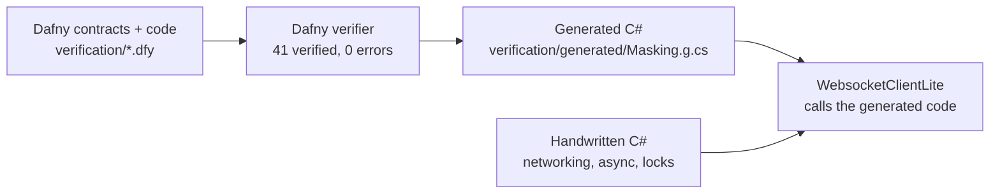

# What you saw in episode 1: the trust gap and the toolbox

[Watch episode 1 on YouTube](https://youtu.be/2MgbZ3ePsgY) · [All episodes](README.md)

This page follows the episode through the repository. For each part of the video it names the files involved,
quotes the lines that matter, and gives the command that checks it. Everything here can be checked on your own
machine.

**Which version.** The episode shows the library as of version 10.3, commit
[`8f8f207`](https://github.com/1iveowl/WebsocketClientLite.PCL/tree/8f8f207) (tag `10.3.0.0`). Every line number
and every quoted excerpt on this page names `8f8f207` and links to the file at that commit. The one exception is
the 2016 code, which names the 2016 commit it is in. Links without a line number go to the current file.

Since 10.3, version 10.4 added the `net11.0` target, and version 10.5 added a contract-weakening experiment,
written rules for the verification work and a check that every contract cites the RFC. No Dafny contract,
protocol test or boundary entry changed. `Protocol.dfy` is the same as at `8f8f207`; `Masking.dfy` gained three
comment lines below the excerpt quoted here.

## The example in one picture

WebsocketClientLite is a WebSocket client for .NET. Its protocol core, the code that frames, masks and validates
WebSocket messages, is written in [Dafny](https://dafny.org). The Dafny verifier proves that this code meets its
contracts for every input. The C# the library runs is generated from the same Dafny source.



| In the video | In the repository |
| --- | --- |
| The protocol core in Dafny | [`verification/Protocol.dfy`](../../verification/Protocol.dfy) and [`verification/Masking.dfy`](../../verification/Masking.dfy) |
| The generated C# | [`verification/generated/Masking.g.cs`](../../verification/generated/Masking.g.cs), compiled into the library by [`WebsocketClientLite.csproj`](../../src/main/WebsocketClientLite/WebsocketClientLite.csproj) |
| The verifier run | [`scripts/dafny-masking.sh`](../../scripts/dafny-masking.sh) |
| The overview | [`docs/protocol-verification.md`](../protocol-verification.md) and [`verification/README.md`](../../verification/README.md) |

The Dafny core came in with version 10.0 (see [CHANGELOG.md](../../CHANGELOG.md#new-in-version-1000)), and the
handwritten C# it replaced was removed.

## The trust gap: the length bug from 2016

The episode tells of a bug that passed every test for ten years. RFC 6455
[section 5.2](https://www.rfc-editor.org/rfc/rfc6455#section-5.2) says: "the minimal number of bytes MUST be used
to encode the length". A payload of 125 bytes fits in the 7-bit length field, so it must be sent as `81 7D`. The
frame `81 7E 00 7D` carries the same 125 in the 16-bit extended field, and a client must refuse it.

- **The 2016 code.** The length parsing as it was first written by hand:
  [`src/main/Parser/TextDataParser.cs` at commit `3e60ed1`, lines 227 to 240](https://github.com/1iveowl/WebsocketClientLite.PCL/blob/3e60ed1/src/main/Parser/TextDataParser.cs#L227-L240).
  `case 126:` selects the 16-bit length, and nothing checks that the length needed 16 bits. Later versions,
  reworked by hand and then with an agent, kept that behaviour.
- **Where it was found.** While the code was read to decide what to prove, the gap was written down in
  [`docs/dafny-pdd-plan.md`](../dafny-pdd-plan.md) under "findings from inspection". It was first rejected in
  pull request #100, the change that brought in the Dafny core.
- **The rule.** `HeaderValid` states it, with the RFC section beside it:
  [`verification/Protocol.dfy` at `8f8f207`, lines 39 to 55](https://github.com/1iveowl/WebsocketClientLite.PCL/blob/8f8f207/verification/Protocol.dfy#L39-L55):

  ```dafny
  // RFC 6455 sections 5.2 and 5.5, mixed with library policy. Section 5.2: the minimal
  // number of bytes MUST be used to encode the length (marker 0-125 is the length, 126 is
  // followed by 126-65535 in 16 bits, 127 by 65536 or more in 64 bits), ...
  ```

  and in the function body, [line 53 at `8f8f207`](https://github.com/1iveowl/WebsocketClientLite.PCL/blob/8f8f207/verification/Protocol.dfy#L53): `if marker < 126 then length == marker as bv64 else if marker == 126 then 126 <= length <= 65535 else length >= 65536`.
- **The test.** `81 7E 00 7D` is a row of `InvalidHeaders`
  ([`PayloadParsingTests.cs` at `8f8f207`, line 241](https://github.com/1iveowl/WebsocketClientLite.PCL/blob/8f8f207/src/main/WebsocketClientLiteTest/PayloadParsingTests.cs#L241);
  the list starts at [line 223](https://github.com/1iveowl/WebsocketClientLite.PCL/blob/8f8f207/src/main/WebsocketClientLiteTest/PayloadParsingTests.cs#L223)). `RejectsMalformedFrames`
  ([line 261](https://github.com/1iveowl/WebsocketClientLite.PCL/blob/8f8f207/src/main/WebsocketClientLiteTest/PayloadParsingTests.cs#L261)) sends it with the payload its
  header announces, so the test passes only if the header itself is refused.
- **The replay.** [`docs/header-length-validation.md`](../header-length-validation.md) runs that test against
  the 9.2.0 parser (`a779602`), the last one before the proof work. It records that the test as first written
  passed there for the wrong reason, how it was made stronger, and that the stronger test fails on the old parser.

## The toolbox

### 1. The spec as a contract

*"Every requirement we prove must be tied to a numbered section of RFC 6455, recorded right next to the proof
obligation."*

The contract the episode shows is `Apply` in
[`verification/Masking.dfy` at `8f8f207`, lines 6 to 13](https://github.com/1iveowl/WebsocketClientLite.PCL/blob/8f8f207/verification/Masking.dfy#L6-L13):

```dafny
// RFC 6455 section 5.3. The key may occupy a larger scratch buffer.
static method Apply(data: array<bv8>, key: array<bv8>, count: Index)
  requires data != key
  requires key.Length >= 4
  requires count as int == data.Length
  modifies data
  ensures forall j :: 0 <= j < data.Length ==>
    data[j] == old(data[j]) ^ key[j % 4]
```

The `ensures` lines are RFC 6455 section 5.3 written as a formula: `transformed-octet-i = original-octet-i XOR
masking-key-octet-j`, with `j = i MOD 4`. At `8f8f207`, every proved declaration in `Protocol.dfy` has a comment
like this beside it: the RFC section it comes from, or "Library policy:" and what the policy is, where the rule is
the library's own choice and not the RFC's. Two lemmas in `Masking.dfy` did not:
[`XorTwice`](https://github.com/1iveowl/WebsocketClientLite.PCL/blob/8f8f207/verification/Masking.dfy#L28) and [`RoundTrip`](https://github.com/1iveowl/WebsocketClientLite.PCL/blob/8f8f207/verification/Masking.dfy#L32), lines 28
and 32 at `8f8f207`. Version 10.5 found them, cited RFC 6455 section 5.3 above both, and made
`./scripts/pdd.sh validate` fail on any uncited declaration ([`tools/Pdd/README.md`](../../tools/Pdd/README.md)). The
requirement map, [`verification/requirements.json`](../../verification/requirements.json), records the same origin
for each of its 16 requirements.

### 2. Proof Driven Development

You state your intent as a formal specification, and a verifier proves that the code meets it, for every input.
The term comes from Ben Goodspeed's paper
[Proof-Driven Development (arXiv:1512.02102, 2015)](https://arxiv.org/abs/1512.02102). Microsoft Research
describes the same approach for agent-written apps, with Verus and Rust, in
[Formally verifying agent-written full-stack web apps with PDD Kit](https://www.microsoft.com/en-us/research/blog/formally-verifying-agent-written-full-stack-web-apps-with-pdd-kit/).

Here the tools are Dafny 4.11.0 and the Z3 4.12.1 solver.
[`scripts/dafny-toolchain.sh`](../../scripts/dafny-toolchain.sh) downloads them from a pinned, checksum-checked
archive, so every run uses the same verifier.

### 3. An explicit trust boundary

Every part of the system is labelled *proved*, *assumed* or *tested*. The table is in
[What is proved, assumed and tested](../protocol-verification.md#what-is-proved-assumed-and-tested).

- **The one assumption inside the proof.** `NativeCopy.CopySlice`
  ([`Protocol.dfy` at `8f8f207`, line 566](https://github.com/1iveowl/WebsocketClientLite.PCL/blob/8f8f207/verification/Protocol.dfy#L566)) is declared `{:extern}`: Dafny
  takes its contract on trust, and `VerifiedNativeCopy.cs`
  ([line 11 at `8f8f207`](https://github.com/1iveowl/WebsocketClientLite.PCL/blob/8f8f207/src/main/WebsocketClientLite/Helper/VerifiedNativeCopy.cs#L11)) implements it with
  `System.Buffer.BlockCopy`. `dafny audit` lists it, and
  [`verification/trusted-boundaries.md`](../../verification/trusted-boundaries.md) is that report. The verifier
  run fails if the report changes, so a new assumption cannot slip in unnoticed. The Dafny sources contain no
  `assume` and no `{:axiom}`.
- **The assumptions around the proof.** [`verification/boundaries.json`](../../verification/boundaries.json) is
  the boundary register: 12 entries, each with what is assumed, what is excluded and what evidence backs it.
  `NATIVE-COPY` ([line 267 at `8f8f207`](https://github.com/1iveowl/WebsocketClientLite.PCL/blob/8f8f207/verification/boundaries.json#L267)) is the copy above. The others
  are what the handwritten C# must do for the proof to apply, for example `PAYLOAD-OWNERSHIP`
  ([line 189](https://github.com/1iveowl/WebsocketClientLite.PCL/blob/8f8f207/verification/boundaries.json#L189), a buffer has one owner) and `CLOSE-LOCK`
  ([line 5](https://github.com/1iveowl/WebsocketClientLite.PCL/blob/8f8f207/verification/boundaries.json#L5), the Close state is changed only under the sender's lock).
- **What is tested, not proved.** The asynchronous and concurrent code, the handshake parsing, string encoding,
  the random masking key and the other C# adapters. See
  [Reading the proof boundary](../../verification/README.md#reading-the-proof-boundary) and
  [Contracts used by production](../../verification/README.md#contracts-used-by-production). CI requires at least
  70 % line coverage ([`scripts/check-coverage.sh`](../../scripts/check-coverage.sh)).

### 4. Tests that start from the spec

The bytes a test expects are worked out from the RFC, not copied from the code's own output.

- `Decode_MatchesRfc6455HelloVector`
  ([`MaskingTests.cs` at `8f8f207`, line 31](https://github.com/1iveowl/WebsocketClientLite.PCL/blob/8f8f207/src/main/WebsocketClientLiteTest/MaskingTests.cs#L31)) uses the example from RFC 6455
  [section 5.7](https://www.rfc-editor.org/rfc/rfc6455#section-5.7): key `37 FA 21 3D`, masked bytes
  `7F 9F 4D 51 58`, text "Hello".
- `RejectsMalformedFrames` and its `InvalidHeaders` rows, above, each come from a MUST in the RFC or from a
  library policy.
- When the code disagrees with the spec, the test is run against the old code and seen to fail before the fix
  is trusted. The [replay record](../header-length-validation.md) for the length rule shows what that takes.

### 5. Keep the proof current

On every pull request into `main`, the `verify-protocol` job in [`ci.yml`](../../.github/workflows/ci.yml) runs
`./scripts/pdd.sh capture --job protocol`. That runs [`scripts/dafny-masking.sh --check`](../../scripts/dafny-masking.sh),
which:

1. compares a fresh `dafny audit` with [`trusted-boundaries.md`](../../verification/trusted-boundaries.md),
2. verifies both Dafny files,
3. generates the C# again and compares it with the checked-in
   [`Masking.g.cs`](../../verification/generated/Masking.g.cs).

Any difference fails the job. The same job then runs the Dafny mutation tests.

**Mutation testing.** [`verification/mutations/`](../../verification/mutations/README.md) holds 17 planted bugs
in the Dafny core, in `close.json` and `payload.json`. Each one makes a single-line edit to a proved method, and
counts as caught only when the verifier fails on the clause it targets. All 17 are caught, two of them in the
length rule (`HEADER-001-short-sixteen-bit` and `HEADER-001-short-sixty-four-bit`).

The C# Close path has its own mutation run with Stryker.NET, in the `stryker-close` job. There the gate is
different: 16 named mutants must be killed by the tests, and every other outcome needs a written, reviewed
disposition in [`stryker-close-dispositions.json`](../../verification/stryker-close-dispositions.json). See
[`stryker-close-pilot.md`](../../verification/stryker-close-pilot.md).

## How the layers fit, and where they stop

| Layer | Evidence in the repository |
| --- | --- |
| Proof | The verifier's last line: `Dafny program verifier finished with 41 verified, 0 errors` |
| Assumptions | One external contract inside the proof ([`trusted-boundaries.md`](../../verification/trusted-boundaries.md)); the register around it ([`boundaries.json`](../../verification/boundaries.json)) |
| Tests | The unit tests on every target framework ([`test-all-tfms.sh`](../../test-all-tfms.sh)), controlled Close schedules, the coverage gate |
| Process | The CI jobs above, and evidence receipts that tie each result to the exact source, tools and runtime ([CI verification receipts](../../verification/README.md#ci-verification-receipts-phase-2-increment-d)) |
| The spec, through all of them | RFC 6455 sections beside the contracts, in `requirements.json`, and in the test rows |

The [layers of proof driven development](../protocol-verification.md#layers-of-proof-driven-development) section
describes them in more detail.

**The limits.** This is not a claim of full RFC 6455 conformance. The proofs cover the protocol core only, not
the whole client. In the repository's own words: "It does not establish full RFC conformance or prove the
asynchronous client" ([`verification/README.md`](../../verification/README.md)), and the verifier, compiler,
runtime and .NET stay trusted components
([What remains outside the proofs](../protocol-verification.md#what-remains-outside-the-proofs)).

## Run it yourself

You need Linux x64, the [.NET 11 SDK](https://dotnet.microsoft.com/download/dotnet/11.0), `curl` and `unzip`. The
repository's dev container has all of them ([docs/development.md](../development.md)). The Dafny toolchain is
downloaded on the first run and cached outside the repository.

```bash
# Verify the Dafny core and check that the generated C# is current (about 10 seconds after the first run).
bash scripts/dafny-masking.sh --check
# ...
# Dafny program verifier finished with 41 verified, 0 errors

# Plant the 17 bugs one at a time and check that the verifier catches each one (about 3 minutes).
./scripts/pdd.sh mutations

# The unit tests against every target framework build.
./test-all-tfms.sh
```

### Two experiments with the length rule

Both start from a clean checkout. Undo each one with `git checkout verification/`.

**Put the 2016 bug back into the code.** In `DecodeHeader` in `verification/Protocol.dfy`, make its last line
([line 80 at `8f8f207`](https://github.com/1iveowl/WebsocketClientLite.PCL/blob/8f8f207/verification/Protocol.dfy#L80)) accept a 125-byte length in the 16-bit field:

```dafny
status := if HeaderValid(first, second, length, limit) || (marker == 126 && length == 125) then 2 else 1;
```

`bash scripts/dafny-masking.sh --check` now ends with `40 verified, 2 errors`: the code no longer meets its
contract, and the verifier says so. This is the kind of bug the mutation catalog plants.

**Weaken the contract instead.** Put the code back, and in `HeaderValid` change `126 <= length <= 65535`
([line 53 at `8f8f207`](https://github.com/1iveowl/WebsocketClientLite.PCL/blob/8f8f207/verification/Protocol.dfy#L53)) to `0 <= length <= 65535`. The verifier now says `41 verified, 0 errors`, although the library would accept
`81 7E 00 7D` again. The code still meets its contract; the contract no longer says what the RFC says. This is
the episode's point that a proof only shows that the code does what the contract says.

The other layers catch it. `--check` fails, because the C# generated from the weaker contract differs from the
checked-in file. On a pull request, the `contract-change-report` job lists every changed contract for a person
to review. And if you regenerate the C# with `bash scripts/dafny-masking.sh --write` and run the parser tests,
the tests built from the RFC fail on exactly that frame:

```bash
dotnet test src/main/WebsocketClientLiteTest/WebsocketClientLiteTest.csproj -c Release -p:LibTfm=net11.0 \
  --filter "FullyQualifiedName~PayloadParsingTests|FullyQualifiedName~ParserRetentionTests"
# Failed PayloadParsingTests.RejectsMalformedFrames(bytes: [129, 126, 0, 125])
# Failed ParserRetentionTests.InvalidHeadersRejectBeforePayloadRead(header: [129, 126, 0, 125], ...)
```

Both experiments were run on 2026-11-14 at version 10.4.0 (`8c5818a`), whose `Protocol.dfy` is the same as at
`8f8f207`. Version 10.5 records the contract experiment in full, for both length bounds, with every command and
output: [Weakening the header length contract](../../verification/contract-weakening.md).
