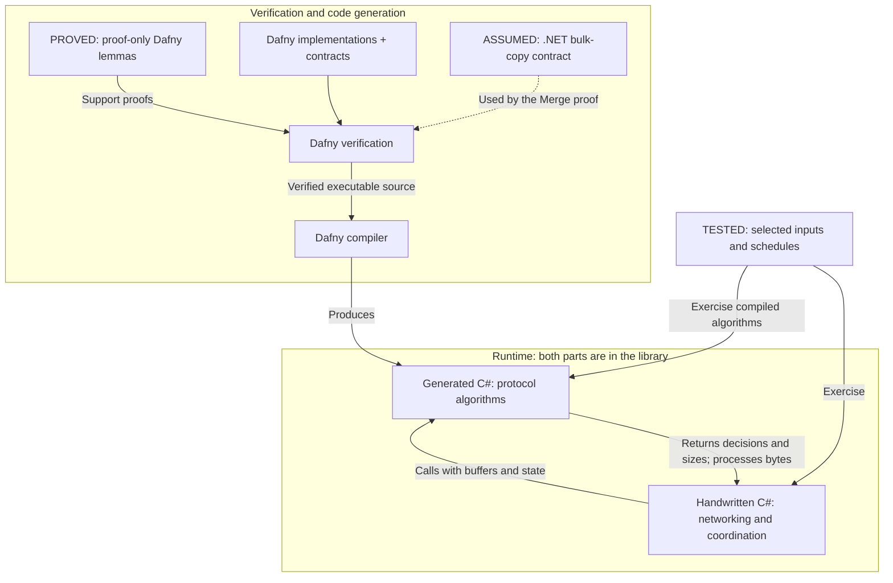
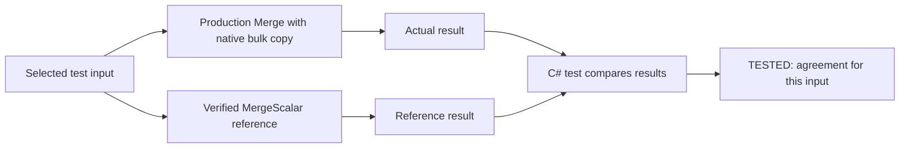

# Protocol verification

## What is proved, assumed and tested

**Dafny verifies our `.dfy` implementations and lemmas, not our handwritten C# or test harnesses.** Verification establishes that an implementation satisfies its written contract for every input allowed by its preconditions. It does not establish that the contract captures every RFC requirement.

Executable Dafny algorithms are compiled into C# so the library runs the implementation whose source was verified. This avoids manually rewriting a proved algorithm in C#. The compiler and runtime remain trusted; Dafny does not separately verify the emitted C# text.

The practical benefit is that the core's contracts cover all permitted inputs, including boundary lengths and state combinations that are easy to miss in example tests. Exact byte-operation contracts protect masking and reassembly; bounded-size and transition contracts constrain frame/message processing. Generated C# brings those algorithms into production without a handwritten translation. This strengthens critical parts of the library and gives maintainers contracts that CI rechecks as implementations change. The caller must still supply valid inputs and use the results correctly.

Inside the runtime box, an arrow from handwritten C# to generated C# means a **method call**, not code generation or a proof dependency. The return arrow shows how the caller receives decisions/sizes or observes processed bytes. For example, `DataframeParsing.ReadDataframeAsync` calls generated `Admit` with the header and current message state, then uses its decision before allocating or reading the payload. Dafny proves the admission algorithm's contract; integration tests check that the handwritten receive path uses it as intended.

**The diagram does not imply that the handwritten C#, test harness or .NET bulk-copy implementation is formally verified.** The compiler, verifier and runtimes are also trusted components.

| Assurance | Applies to | Limit |
| --- | --- | --- |
| **Proved** | Dafny algorithms and proof-only lemmas | Their written contracts, preconditions and explicit assumptions; not complete RFC conformance |
| **Assumed** | The `NativeCopy.CopySlice` contract describing `.NET Buffer.BlockCopy` | Dafny does not inspect or prove the C# adapter or .NET implementation |
| **Assumed** | Correct operation of the verifier, solver, compiler and runtimes | These tools are not verified by this project's proofs |
| **Tested and reviewed** | Handwritten C# integration, precondition checks, locking, networking and test harnesses | Evidence for selected inputs and schedules; not a proof of all possible behavior |

Proof-only lemmas establish mathematical facts used by the implementation proofs. For example, `XorTwice` proves that applying XOR with the same key twice restores the original byte. It does not prove that a handwritten C# loop chooses the correct key or processes every byte. `PartsPrefix` and `NetworkWord` support the concatenation and length proofs in the same way. These lemmas are omitted from executable code, and we have not proved equivalence between them and our handwritten C# implementations.

The C# callers must establish generated methods' preconditions, such as valid buffer ranges and no concurrent mutation. Those caller obligations remain reviewed and tested. Calling a verified method does not make its caller verified.

## Testing against a verified reference

Tests use generated code both as the implementation under test and as a reference for comparison. Tests of generated protocol methods exercise the compiled C# integration; they do not replace the source proof or prove the surrounding test harness.

For reassembly, tests compare production `Merge` with the fully verified `MergeScalar` reference and with independently calculated expected bytes. This is **testing against a verified reference**, sometimes called a verified test oracle.

**The reference algorithm is proved against its contract. The comparison test is not proved, and passing it does not establish equivalence for every input.** The production `Merge` algorithm also has its own concatenation proof, conditional on the bulk-copy contract. The comparison tests provide additional evidence; they do not remove that assumption or prove `Buffer.BlockCopy`.

The project therefore uses a formally verified protocol core with tested C# integration. Neither test counts nor line coverage measure the proportion of the client that is formally verified.

## Version 10.1.0 additions

The verified core now includes combined header/message admission before payload reads, transmit-state and closing-state decisions, exact segment concatenation, and a theorem composing the length encoder with the decoder. List sends retain exclusive data-message ownership across fragments while allowing controls; invalid list items fail before transmission. Failed partial sends cannot silently resume normal data traffic. Asynchronous disposal waits for the peer's Close response or a bounded timeout.

These changes extend the synchronous guarantees. They do not prove the C# semaphores, async scheduling, socket progress or timer delivery. In particular, production `Merge` proves concatenation assuming an explicit contract for .NET `Buffer.BlockCopy`; the retained `MergeScalar` reference proves the byte loop itself. The C# receive loop remains responsible for retaining the correct arrays and supplying their total length. The [verification guide](../verification/README.md#1010-state-and-composition-proofs) maps every new guarantee to its production caller and trusted boundary.

Local validation of the 10.1.0 changes passed 41 verification results and the generated-source/trust-audit checks, plus 184 tests for each of five library targets. Coverage is 82.3% lines and 75.6% branches. The Release build is warning-free. See the [current validation record](../verification/README.md#1010-local-validation) for negative proof checks and the bulk-copy performance tradeoff.

## Version 10.0.0 foundation

Version 10.0.0 adds a verified synchronous core to WebsocketClientLite. Critical frame parsing, fragmentation decisions, buffer sizing, header encoding and masking operations are written in Dafny and compiled to C#. The library calls that generated code in production.

This work also corrects protocol behavior: malformed server frames are rejected before payload allocation, fragmented messages follow an explicit state machine, and a connection is accepted only after validating the server's handshake against the request that was actually sent.

## What proof driven development means here

Tests check selected examples. Dafny checks whether an implementation written in Dafny satisfies its contract for every input allowed by its preconditions, assuming any declared external contracts. For example, the masking contract states which XOR result every output byte must contain, which bytes must remain unchanged, and which array bounds must hold.

The process is to state the intended behavior, prove the implementation against it, generate C#, and test the integration. A proof of a separate model would leave a gap between the model and the running code; using generated code connects the verified algorithm to the library.

The contracts express the relevant rules from [RFC 6455](https://www.rfc-editor.org/rfc/rfc6455.html). They still need human review: proving that code satisfies a specification does not prove that the specification correctly captures every requirement of the RFC.

## What we proved

These guarantees hold under the methods' stated preconditions, including valid buffer ranges and no concurrent mutation of their arrays.

| Area | Proven property |
| --- | --- |
| Incoming frame headers | The decoder distinguishes incomplete, rejected and accepted headers without reading unavailable extended-length bytes. Acceptance requires supported framing, canonical length encoding and a payload length within both the configured limit and the array-size bound. |
| Length decoding | Extended lengths equal the big-endian numeric value of the supplied bytes. |
| Fragmentation decisions | The state machine accepts only its defined opcode/state transitions. Rejection leaves state unchanged. Accepted accumulated sizes stay within the limit. Ping/Pong preserve a pending message; Close terminates it. A data message completes only on FIN. |
| Outgoing frame sizing | Accepted frames have the canonical header size, valid FIN/opcode mapping and control-frame constraints. Header plus payload fits the supported integer range. |
| Header encoding | The generated writer produces the specified marker and network-order length bytes while preserving the key and payload region. |
| Outgoing masking | Every destination byte has the specified XOR value. Copy-and-mask preserves the source; both masking operations preserve bytes outside their destination slice. Array accesses stay in bounds and the loops terminate. In-place masking also preserves its key region. |

Handshake and Close acceptance are implemented as Dafny predicates. The handshake predicate requires every supplied acceptance condition; the Close predicate checks length, allowed status codes and the supplied UTF-8-validity result. These predicates make the acceptance rules explicit and executable. They do **not** prove the C# computations that supply those conditions, such as calculating the accept hash or decoding UTF-8.

Encoding and decoding are tested together against independent byte expectations. Version 10.1.0 adds a length-header composition theorem; full frame/payload equivalence is still outside its scope.

## What improved

**Invalid frames fail before payload allocation.** The client now rejects masked server frames, unsupported reserved bits and opcodes, nonminimal length encodings, invalid control frames and oversized lengths. Protocol constraints and resource limits are checked together before reading the payload into a new buffer.

**Fragmented messages follow explicit rules.** A continuation cannot arrive without a pending message, and a new Text or Binary frame cannot replace an unfinished message. Interleaved Ping/Pong frames preserve reassembly state; Close discards the unfinished message. Completed messages have consistent length and fragment metadata. UTF-8 validation runs after text reassembly, so a valid character may span several frames.

**Handshake success means more than HTTP status 101.** The server's accept value is checked against the random key sent in that request. The client also checks the HTTP version, Upgrade/Connection tokens and selected subprotocol. An unoffered or multiple subprotocol selection is rejected; omitting selection is allowed. Unsupported extensions are rejected, and custom headers cannot override protocol-owned request fields. Invalid responses fail when their headers finish, even if the server leaves the connection open.

**Outgoing framing and Close handling are stricter.** Size arithmetic is checked before renting a frame buffer. Outgoing control frames must satisfy their size and fragmentation constraints, and an explicit final continuation now sets FIN correctly. Close payloads reject one-byte bodies, forbidden status codes and invalid UTF-8 reasons. String encoding rejects invalid UTF-16 input instead of silently replacing it.

**Future changes have a repeatable check.** CI is configured to run the pinned verifier and compare regenerated C# with the checked-in output. A change to a verified Dafny implementation that violates its contract fails verification; stale generated code fails the comparison. Handwritten C# changes are checked by the build, analyzers, tests and review, not by Dafny. The trust audit detects changes to the reported assumptions and external contracts; it does not prove their implementations. The existing build, tests and coverage gate remain in place.

## What remains outside the proofs

Dafny does not verify any of this project's handwritten C# implementations, including synchronous adapters, async/await code and test harnesses. The following remain reviewed or tested boundaries:

- Socket reads and writes, cancellation, scheduling, Rx delivery and disposal races.
- Applying state transitions from C#, retaining the right fragments and delivering the completed message. Concatenation of supplied arrays is now proved by `Merge`, conditional on the documented .NET bulk-copy contract.
- ArrayPool ownership and buffer lifetime across asynchronous writes.
- HTTP parsing, header/token interpretation, SHA-1/Base64, random key generation and UTF-8 decoding.
- Closing-handshake timing, close-code selection and C# lock ownership. List sends now hold a message gate; manually supplied continuation sequences still need one application owner.

The optional legacy single-byte empty-Pong behavior remains outside standard framing guarantees. The work is not a proof of the entire client or a claim of complete RFC conformance. The verifier, compiler, runtime, .NET and the adapters that establish preconditions remain trusted components.

## Historical 10.0.0 validation and performance

The following results describe local validation before the 10.0.0 release. For 10.1.0 results and release status, see the [current validation record](../verification/README.md#1010-local-validation). The 10.0.0 validation produced:

- **23 successful Dafny verification results**, with no errors, followed by a successful generated-source consistency check. This number includes specification well-formedness checks; it is not a count of independently proved RFC rules.
- **161 passing tests per library target**, across all five targets, using a .NET 10 test host.
- **79.9% line coverage**, above the existing 70% requirement, with generated source included.
- Successful Release builds and independent package-consumer builds for every target framework.

A deliberately incorrect XOR-to-OR change in copy-and-mask failed its output contract, confirming that the proof detects that implementation error.

Local .NET 10.0.14 microbenchmarks measured zero allocations in the active masking loops. Fused copy-and-mask was approximately 10–12% faster than the comparable scalar loop; in-place masking was approximately 6% faster, for the measured 125-byte, 1 KiB and 64 KiB payloads. These are kernel measurements on one environment, not end-to-end network speed guarantees.

The retained whole-array masking pilot helper is no longer used by the receive path, because masked server frames are rejected. Its final benchmark was slower than its original scalar comparison. The [verification guide](../verification/README.md) records that result alongside the active sender measurements and explains how to reproduce them.

## Using and maintaining the library

Consumers do not need to install Dafny or Z3. Generated C# is built into the library; version 10.0.0 adds the `DafnyRuntime` 4.11.0 package dependency. All existing target frameworks remain supported.

The stricter validation can reject malformed traffic or custom handshake headers that earlier versions accepted. Applications relying on those behaviors should check their server responses and connection options when upgrading.

For source files, exact contracts, trusted boundaries, toolchain versions and regeneration commands, see the [verification guide](../verification/README.md). The [original adoption plan](dafny-pdd-plan.md) records the intended scope and sequence.
